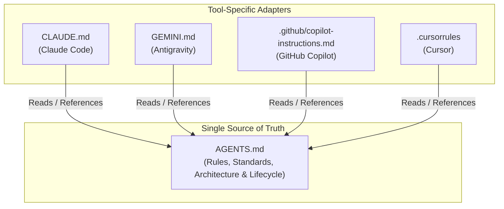

# AI Assistants Configuration Strategy (SSOT)

This document details the configuration strategy adopted for this repository to coordinate multiple AI coding assistants (**Claude Code**, **Antigravity**, **GitHub Copilot**, and **Cursor**) without duplicating information or introducing inconsistencies.

> [!TIP]
> To replicate this setup in other projects, refer to the reusable blueprint: **[universal-ai-blueprint.md](./universal-ai-blueprint.md)**.

---

## 1. The Duplication Problem

Modern AI coding assistants look for specific configuration files in different locations:

- **Claude Code**: Looks for `CLAUDE.md` in the project root.
- **Antigravity**: Hierarchically loads `GEMINI.md` and `AGENTS.md` into its context.
- **GitHub Copilot**: Reads `.github/copilot-instructions.md` and settings defined in `.vscode/settings.json`.
- **Cursor**: Reads `.cursorrules` in the project root.

Copying and pasting identical project guidelines (architecture, coding conventions, styling rules, workflows, etc.) across each file creates:

- **Technical debt:** Updating a guideline requires editing 3 or more separate files.
- **Inconsistencies:** Over time, assistants receive outdated or contradictory instructions.
- **Context waste:** Large redundant configuration files consume unnecessary tokens.

---

## 2. The Solution: Single Source of Truth (SSOT)

We centralize **all** project guidelines into a single canonical file: **`AGENTS.md`**.  
The other files serve as **lightweight adapters (shims/pointers)** that consume minimal tokens and direct the AI models to the single source of truth.



---

## 3. Structure and File Roles

### 1. `AGENTS.md` _(Core / SSOT)_

- **Location:** Project root.
- **Contents:**
  - General project context, goals, and standard technologies.
  - Architectural standards, coding style, and naming conventions.
  - Formatting and development tools (Prettier, ESLint).
  - Universal workspace customization directory (`.agents/`).

### 2. `CLAUDE.md` _(Adapter for Claude Code)_

- **Location:** Project root.
- **Role:** Direct relative pointer to `./AGENTS.md` with Claude Code CLI workflow notes.

### 3. `GEMINI.md` _(Adapter for Antigravity)_

- **Location:** Project root.
- **Role:** Direct relative pointer to `./AGENTS.md`. Antigravity automatically discovers both files, keeping context unified.

### 4. `.github/copilot-instructions.md` _(Adapter for GitHub Copilot)_

- **Location:** `.github/`
- **Role:** Direct relative pointer to `../AGENTS.md` accompanied by concise directives optimized for the real-time inline completion engine.

### 5. `.cursorrules` _(Adapter for Cursor)_

- **Location:** Project root.
- **Role:** Direct relative pointer to `./AGENTS.md` ensuring Cursor loads the single source of truth for both chat and composer workflows.

---

## 4. Universal Workspace Customization Directory (`.agents/`)

Rather than maintaining separate, proprietary vendor directories for each assistant (`.claude/`, `.gemini/`, etc.), this project adheres to the universal cross-agent standard rooted in **`.agents/`**:

```text
.agents/
├── agents/        # Specialized agent definitions and roles
├── hooks/         # Lifecycle hooks (e.g., pre-tool/post-tool scripts)
├── instructions/  # Extended modular instruction sets
├── plugins/       # Namespaced bundles of skills, rules, and configurations
├── prompts/       # Reusable prompt templates and query patterns
├── scripts/       # Automation scripts executable by agents
└── skills/        # Reusable procedural skills with SKILL.md definitions
```

### Git Tracking with `.gitkeep`

Because Git does not track empty directories by default, each subdirectory in `.agents/` contains a `.gitkeep` file (`.agents/<folder>/.gitkeep`). This ensures that the entire folder structure is preserved when checking into Git, pushing to remotes (e.g., GitHub), and cloning across different machines.

---

## 5. Maintenance Guide

Whenever a project rule needs to be added, updated, or removed (such as adding a new naming convention or modifying linter rules):

1. **Edit exclusively [AGENTS.md](../AGENTS.md).**
2. **Do not modify** `CLAUDE.md`, `GEMINI.md`, or `.github/copilot-instructions.md`, as they automatically point to the Single Source of Truth.
3. If an additional assistant is adopted in the future (e.g., Windsurf, Aider, or Codex), simply create its minimal adapter referencing `AGENTS.md`.
