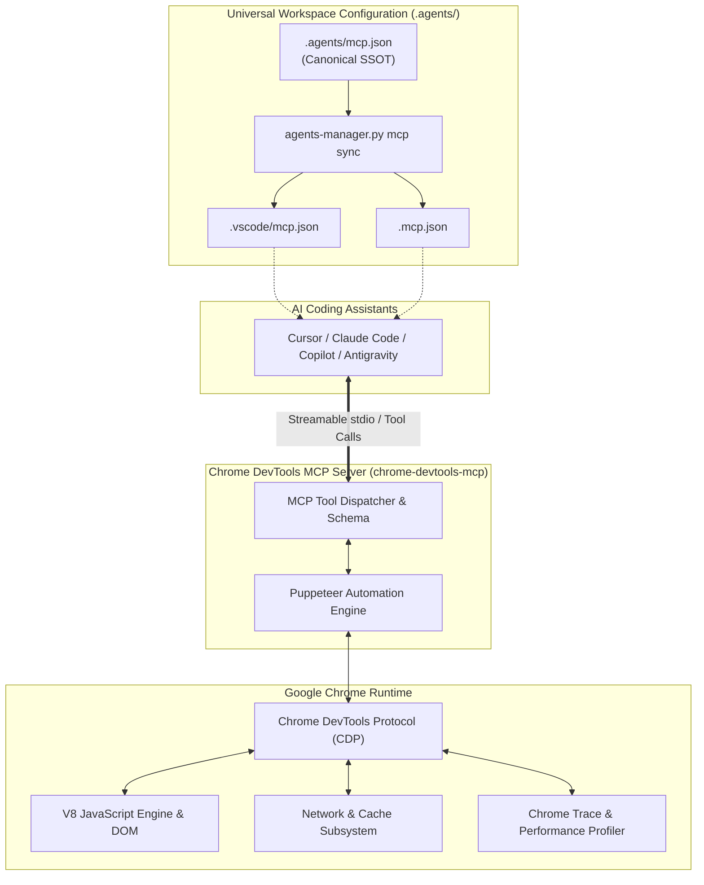

# Chrome DevTools MCP Server Guide

This document details the architecture, configuration, tooling, and diagnostic capabilities of the **Official Chrome DevTools Model Context Protocol (MCP) Server** (`chrome-devtools-mcp`). Maintained by the **Google Chrome DevTools team**, it connects AI coding assistants directly to live Chrome browser sessions via the **Chrome DevTools Protocol (CDP)** and **Puppeteer**.

---

## 1. Overview & Architecture

The **Chrome DevTools MCP Server** provides deep, runtime introspection and control over Google Chrome. While test-oriented MCP servers (such as Playwright) prioritize end-to-end assertions and compact accessibility snapshots, Chrome DevTools MCP specializes in **live debugging, network tracing, console analysis, CSS style inspection, and performance profiling**.



---

## 2. Comparison: Chrome DevTools MCP vs. Playwright MCP

Both servers provide browser automation, but they serve complementary roles within modern AI-driven development:

| Capability | Chrome DevTools MCP (`chrome-devtools-mcp`) | Playwright MCP (`@playwright/mcp`) |
| :--- | :--- | :--- |
| **Primary Focus** | **Deep runtime diagnostics & debugging** (network, console, CSS, traces) | **End-to-End testing & user journey validation** |
| **Protocol** | Chrome DevTools Protocol (CDP) + Puppeteer | Playwright Automation Protocol |
| **Supported Browsers** | Google Chrome (Stable, Canary, Chromium) | Chromium, Firefox, WebKit, MS Edge |
| **Page Representation** | Text-based DOM snapshots with `uid` references & visual screenshots | Text-based Accessibility (a11y) tree |
| **Console & Logs** | Full source-mapped console errors, warnings, stack traces | Basic console output |
| **Network Inspection** | Request/response headers, status, timing, cookies, bodies | Request failure reporting |
| **CSS & Styles** | Inspect computed styles, matched cascade rules, inline CSS | Limited to DOM attributes |
| **Performance** | Native Chrome performance traces, Core Web Vitals, Lighthouse | Navigation timing |
| **Attach to Live Browser** | **Yes** (`--autoConnect` or `--browser-url=http://...`) | Runs standalone browser instances |

---

## 3. Configuration & Multi-Agent Synchronization

Under this repository's architectural guidelines ([AGENTS.md](../AGENTS.md)), MCP servers are maintained in the canonical `.agents/mcp.json` file and synchronized across all tool adapters.

### A. Canonical Configuration ([.agents/mcp.json](../.agents/mcp.json))
```json
{
  "mcpServers": {
    "chrome-devtools": {
      "command": "npx",
      "args": [
        "-y",
        "chrome-devtools-mcp@latest"
      ],
      "env": {},
      "description": "Official Chrome DevTools MCP server for live Chrome browser inspection, debugging, console/network analysis, and performance profiling via CDP"
    }
  }
}
```

### B. Synchronizing Adapters
Run the workspace sync script to propagate the server definition across all client adapters:
```bash
python3 .agents/scripts/agents-manager.py mcp sync
```

* **VS Code / GitHub Copilot:** Reads `.vscode/mcp.json`.
* **Cursor / Claude Code:** Reads `.mcp.json` in the workspace root.

---

## 4. Exposed Tools Reference

The server exposes 20+ specialized tools categorized by operational domain:

### 4.1. Navigation & Page Management
| Tool Name | Parameters | Purpose |
| :--- | :--- | :--- |
| `new_page` | `url` | Opens a new browser tab and navigates to the given URL. |
| `navigate_page` | `url`, `pageId` | Navigates the selected page to a target URL or reloads. |
| `select_page` | `pageId` | Switches active focus to a specific tab/page. |
| `list_pages` | None | Lists all open browser tabs and their unique page identifiers. |
| `close_page` | `pageId` | Closes a specified browser tab. |
| `wait_for` | `text`, `timeout` | Suspends execution until specified text or an element appears. |

### 4.2. User Input & Form Automation
| Tool Name | Parameters | Purpose |
| :--- | :--- | :--- |
| `click` | `uid`, `pageId` | Clicks an element identified by its snapshot `uid`. |
| `fill` | `uid`, `value` | Types text into an input, textarea, or contenteditable element. |
| `fill_form` | `fields`, `pageId` | Atomically fills multiple form controls in a single request. |
| `hover` | `uid` | Moves cursor over an element to reveal hover states/menus. |
| `press_key` | `key` | Sends keystrokes (`Enter`, `Tab`, `ArrowDown`, `Control+C`). |
| `drag` | `fromUid`, `toUid` | Performs drag-and-drop interactions between two elements. |
| `handle_dialog` | `action`, `promptText` | Accepts, dismisses, or provides input to browser alert/confirm prompts. |
| `upload_file` | `uid`, `filePath` | Attaches a file from the workspace to a file input element. |

### 4.3. Inspection, CSS & Console Diagnostics
| Tool Name | Parameters | Purpose |
| :--- | :--- | :--- |
| `take_snapshot` | `pageId` | Generates a structured DOM snapshot mapping elements to `uid`s. |
| `take_screenshot` | `pageId`, `fullPage` | Captures a visual image of the page or element. |
| `list_console_messages` | `pageId` | Fetches console logs, errors, and warnings with stack traces. |
| `get_console_message` | `messageId` | Inspects full details of an individual console entry. |
| `get_css_styles` | `uid` | Extracts computed CSS properties and matched cascade rules for an element. |
| `evaluate_script` | `script` | Executes arbitrary JavaScript expressions within the page context. |

### 4.4. Network Analysis & Performance Profiling
| Tool Name | Parameters | Purpose |
| :--- | :--- | :--- |
| `list_network_requests` | `pageId` | Lists all intercepted HTTP requests, status codes, and timings. |
| `get_network_request` | `requestId` | Retrieves full request/response headers, payloads, and cookies. |
| `performance_start_trace`| `pageId` | Begins recording a native Chrome performance trace. |
| `performance_stop_trace` | `pageId`, `outputPath`| Stops recording and analyzes trace data for main-thread bottlenecks. |
| `lighthouse_audit` | `pageId`, `categories` | Runs Lighthouse audits covering Performance, Accessibility, and Best Practices. |

---

## 5. Configuration Arguments & Flags

You can customize the server's runtime behavior by adding flags to `"args"` in `.agents/mcp.json`:

| Flag | Description | Default |
| :--- | :--- | :--- |
| `--headless` | Launches Chrome in headless mode without a visible window. | Headed GUI |
| `--autoConnect` | Automatically attaches to an existing running Chrome instance (Chrome 144+). | Launches new browser |
| `--browser-url=<url>` | Connects to a running Chrome instance via remote debugging port (e.g. `http://127.0.0.1:9222`). | None |
| `--channel=<channel>` | Selects Chrome distribution channel (`stable`, `canary`, `beta`, `dev`). | `stable` |
| `--filesystemRoot=<path>`| Restricts file access (screenshots, traces, extensions) to a safe workspace path. | Current directory |
| `--categoryExtensions=true` | Enables Chrome extension management tools (`install_extension`, `list_extensions`). | `false` |
| `--no-usage-statistics` | Disables anonymous telemetry and diagnostic metric collection. | Enabled |

---

## 6. Attaching to an Existing Chrome Browser

If you want the AI assistant to inspect your current browsing session or an authenticated web application:

1. **Launch Chrome with Remote Debugging:**
   * **macOS:**
     ```bash
     /Applications/Google\ Chrome.app/Contents/MacOS/Google\ Chrome \
       --remote-debugging-port=9222 \
       --user-data-dir="/tmp/chrome-debug-profile"
     ```
   * **Linux:**
     ```bash
     google-chrome --remote-debugging-port=9222 --user-data-dir="/tmp/chrome-debug-profile"
     ```
   * **Windows:**
     ```cmd
     start chrome.exe --remote-debugging-port=9222 --user-data-dir="%TEMP%\chrome-debug-profile"
     ```

2. **Configure `.agents/mcp.json`:**
   ```json
   "chrome-devtools": {
     "command": "npx",
     "args": [
       "-y",
       "chrome-devtools-mcp@latest",
       "--browser-url=http://127.0.0.1:9222"
     ]
   }
   ```

3. **Sync Adapters:**
   ```bash
   python3 .agents/scripts/agents-manager.py mcp sync
   ```

---

## 7. Workspace Integration

This workspace includes dedicated resources configured to operate alongside `chrome-devtools-mcp`:

* **Specialized Agent ([.agents/agents/devtools-regression-investigator.md](../.agents/agents/devtools-regression-investigator.md)):** Diagnoses broken user flows, form submission errors, and runtime console issues using Chrome DevTools.
* **Specialized Skill ([.agents/skills/chrome-devtools/SKILL.md](../.agents/skills/chrome-devtools/SKILL.md)):** Provides agents with prompt instructions for navigating, inspecting styles, capturing traces, and evaluating scripts without hallucinations.

---

## 8. Security & Best Practices

1. **Full Browser Control:** The MCP server possesses complete execution and inspection capabilities over the browser session. Avoid logging into sensitive production accounts or entering credentials while an automated agent is active.
2. **Local Sandbox Bounds:** Use `--filesystemRoot` to restrict file read/write operations to safe workspace directories.
3. **Trace and Memory Dumps:** Performance traces and memory snapshots can be large (50MB+); ensure they are directed to `.gitignore`d temporary directories (`tmp/` or `.agents/scratch/`).
