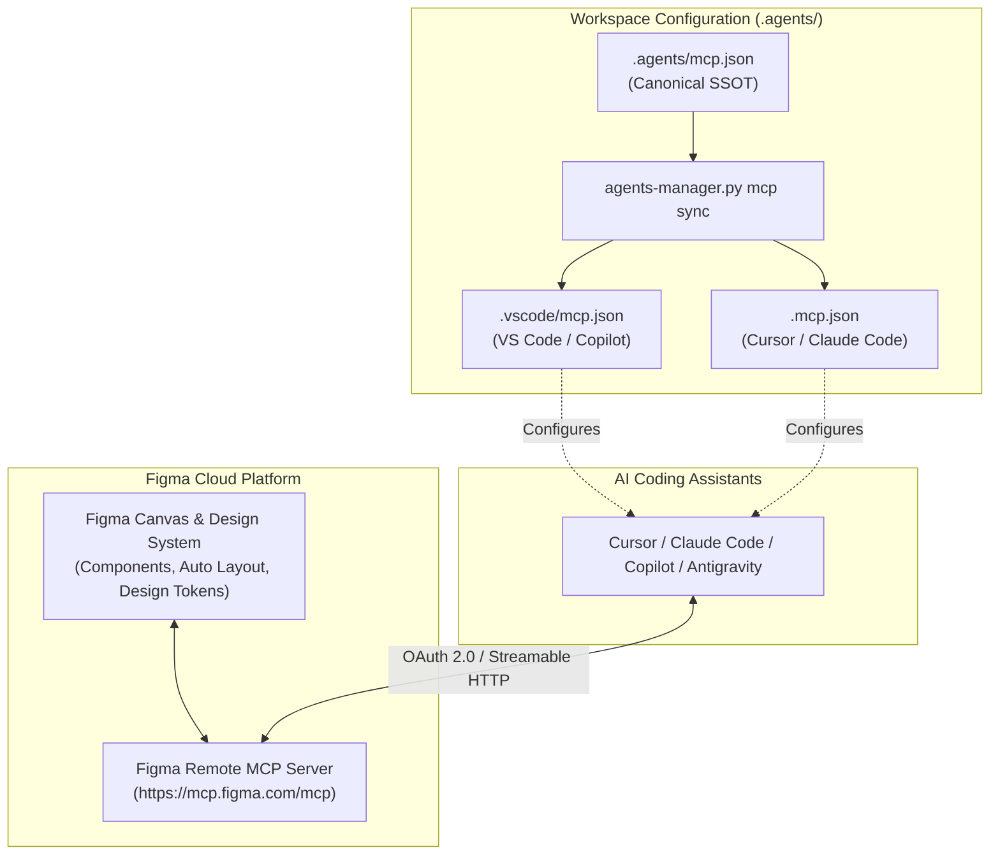
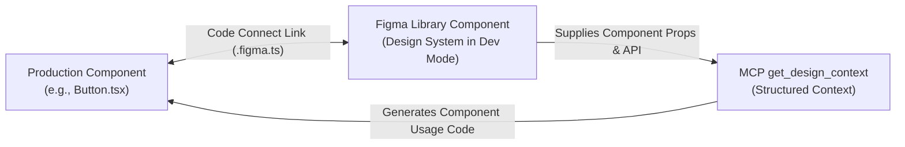

# Figma MCP Server Guide

This document outlines the architecture, setup, capabilities, and restrictions of the **Figma Model Context Protocol (MCP) Server**. It serves as a comprehensive reference for developers and AI coding assistants (**Cursor**, **Claude Code**, **Antigravity / Gemini CLI**, and **VS Code / GitHub Copilot**) working in this repository.

---

## 1. Overview & Architecture

The Figma MCP server acts as an open, standardized bridge between Figma files and AI coding assistants. Instead of relying purely on visual screenshots or manual copy-pasting of CSS properties, the MCP server provides AI models with direct access to Figma's underlying semantic node tree, Auto Layout rules, design tokens, and component mappings.



---

## 2. Server Deployment Options

Figma supports two primary MCP server models:

| Dimension | Remote Server (Recommended) | Desktop Server |
| :--- | :--- | :--- |
| **Endpoint** | `https://mcp.figma.com/mcp` | `http://127.0.0.1:3845/mcp` |
| **Transport** | Streamable `HTTP` / `SSE` | Local `HTTP` |
| **Required Software** | None (connects directly to Figma Cloud) | Figma Desktop App (must be open & running) |
| **Canvas Write Capabilities** | **Yes** (supports creating & updating frames/components) | Primarily read-only for active desktop file |
| **Ideal For** | Standard workflows across all AI coding assistants | Strict corporate/government networks or offline drafts |

> [!TIP]
> You can work in the **Figma Desktop App** while using the **Remote Server**. Because Figma Desktop continuously syncs with the cloud in real-time, the Remote Server reads your live desktop changes without needing local port forwarding.

---

## 3. Configuration & Multi-Agent Synchronization

In accordance with this repository's architectural guidelines ([AGENTS.md](../AGENTS.md)), MCP servers are maintained in a single canonical file and synchronized to client adapters.

### A. Canonical Workspace Configuration (`.agents/mcp.json`)

Register the Figma server under `mcpServers`:

```json
{
  "$schema": "./schemas/mcp.schema.json",
  "version": "1.0.0",
  "mcpServers": {
    "figma": {
      "type": "http",
      "url": "https://mcp.figma.com/mcp",
      "description": "Official Figma remote MCP server for design context, canvas automation, and Code Connect"
    }
  }
}
```

### B. Synchronizing Adapters
Run the workspace automation script to update `.vscode/mcp.json` and root `.mcp.json` in lockstep:

```bash
python3 .agents/scripts/agents-manager.py mcp sync
```

* **VS Code & GitHub Copilot:** Reads `.vscode/mcp.json` automatically.
* **Cursor & Claude Code:** Reads `.mcp.json` in the project root.

> [!NOTE]
> By configuring the server at the workspace level, all team members and AI assistants share identical configurations without needing manual global setup. Avoid adding duplicate global entries in Cursor Settings or Claude CLI to prevent duplicate tool registrations.

---

## 4. How the Figma MCP Server Works

### Initial Authentication Flow
1. The assistant initiates an action that calls a Figma tool (e.g., inspecting a URL).
2. The MCP client pauses and requests authorization, opening a secure browser window to `figma.com/oauth`.
3. The user grants read/write permissions to their Figma account.
4. The client caches the OAuth credentials securely for subsequent calls.

### Core Tools Exposed by the Server

| Tool Name | Operation | Typical Parameters | Description |
| :--- | :--- | :--- | :--- |
| `get_design_context` | Read | `fileKey`, `nodeId` | Extracts complete layout specifications, Auto Layout constraints (padding, gaps, flex direction), typography, color tokens, and generated component code snippets (React/Tailwind/Swift). |
| `use_figma` | Read / Write | `code`, `fileKey`, `skillNames` | Executes JavaScript directly within the Figma Plugin API runtime. Allows reading deep node hierarchies or programmatically creating frames, components, and variables on the canvas. |
| `get_code_connect_suggestions`| Read | `fileKey`, `nodeId` | Scans selected frames to identify reusable components that lack Code Connect mappings. |
| `generate_diagram` | Write | `diagramType`, `code` | Renders flowcharts, state diagrams, or Mermaid syntax directly into a FigJam document. |
| `create_new_file` | Write | `name`, `type` | Programmatically instantiates new Design files or FigJam canvases. |

### Node ID URL Normalization
Figma browser URLs separate node IDs with hyphens, whereas Figma API endpoints require colons:
- **URL format:** `https://www.figma.com/design/:fileKey/:name?node-id=4185-3778`
- **Normalized MCP API parameter:** `nodeId: "4185:3778"`

AI assistants equipped with workspace skills perform this conversion automatically.

---

## 5. Figma Code Connect Integration

**Figma Code Connect** links production code in your repository directly to UI components in Figma:



> [!NOTE]
> The labels on the arrows above (`Supplies Component Props & API`, `Generates Component Usage Code`) represent conceptual data flow actions, not files in the repository.

When an AI assistant requests context for a component mapped via Code Connect, `get_design_context` returns the **exact production component signature** from your codebase rather than synthesizing generic HTML or ad-hoc Tailwind classes.

### Setup Steps for Code Connect:
1. **Install CLI tool:**
   ```bash
   npm install --save-dev @figma/code-connect
   ```
2. **Initialize configuration:**
   ```bash
   npx figma connect init
   ```
3. **Register TypeScript Types in `tsconfig.json`:**
   ```json
   {
     "compilerOptions": {
       "types": ["@figma/code-connect/figma-types"]
     }
   }
   ```
4. **Publish templates:**
   ```bash
   FIGMA_ACCESS_TOKEN="figd_..." npx figma connect publish
   ```

---

## 6. Restrictions and Limitations

When utilizing the Figma MCP server, be aware of the following plan and technical constraints:

### Plan & Seat Requirements
* **Design Inspection (`get_design_context`):** Available on Starter (Free) and above, provided the user has file view access and Dev Mode access.
* **Canvas Write (`use_figma` mutations):** Writing to shared files or design systems requires a **Paid Seat** (Professional, Organization, or Enterprise). Editing on Starter plans is restricted to personal Drafts.
* **Code Connect:** Requires a Figma **Organization** or **Enterprise** plan. It is unavailable on Starter or Professional tiers.

### Technical & Execution Boundaries
1. **Token & Payload Limits:** Requesting context for an entire complex page with hundreds of nested frames can exceed LLM context windows or timeout. **Best Practice:** Pass deep URLs pointing to specific target frames (`?node-id=...`).
2. **Desktop Server Uptime:** The local server (`127.0.0.1:3845`) fails with `ECONNREFUSED` if the Figma Desktop app is closed or if Dev Mode's local server toggle is disabled.
3. **OAuth Expiration:** OAuth sessions will periodically expire and require a quick browser re-authorization.
4. **Font Pre-loading in Plugin API:** When executing mutating code via `use_figma`, any text alteration must await `figma.loadFontAsync(...)` prior to setting `.characters`.

---

## 7. Prompting Best Practices

To get the most accurate output from AI coding assistants using Figma MCP:

* **Always provide specific node URLs:**
  ```text
  "Implement the navigation bar from this link using our React and Tailwind setup:
  https://www.figma.com/design/AbCdEfGhIjKlMnOpQrSt/DesignSystem?node-id=102-304"
  ```
* **Explicitly reference local styling rules:**
  ```text
  "Extract the design context for the modal component and match our existing Button and Dialog components in src/components/ui/."
  ```
* **Avoid unnecessary manual tool mentions:** Coding assistants automatically select `get_design_context` when provided with a Figma URL.
