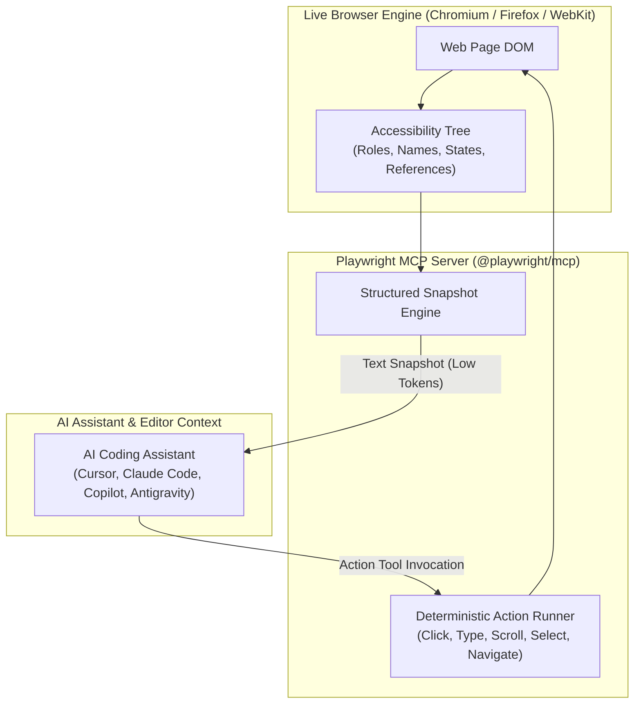
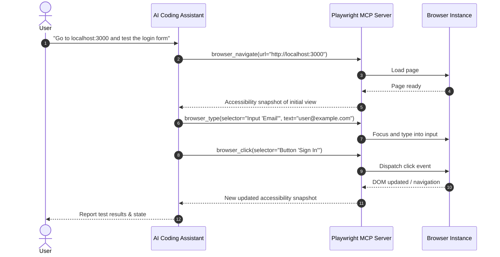

# Playwright MCP Server Guide

This document explains the architecture, configuration, core tools, and usage workflows for the **Official Playwright Model Context Protocol (MCP) Server** (`@playwright/mcp`) and the **Playwright Agent CLI** (`@playwright/cli`).

---

## 1. Overview & Architecture

The **Playwright MCP Server** enables AI coding assistants (**Cursor**, **Claude Code**, **Antigravity**, **VS Code / Copilot**) to perform structured, deterministic browser automation and end-to-end testing.

Unlike traditional AI web agents that rely strictly on expensive and error-prone screenshot-based vision models, Playwright MCP operates on the browser's **Accessibility (a11y) Tree**:



### Key Advantages:
1. **Token Efficiency:** Web pages are converted into compact text-based accessibility trees instead of heavy image payloads.
2. **Determinism:** Interacting with elements uses semantic references (e.g. `role: button, name: 'Submit'`) rather than guessing $(x, y)$ screen pixel coordinates.
3. **No Vision Model Required:** Standard reasoning models can reliably parse and interact with web pages without multimodal visual overhead.

---

## 2. Configuration & Multi-Agent Synchronization

In accordance with this repository's architectural guidelines ([AGENTS.md](../AGENTS.md)), the Playwright MCP server is declared in the canonical `.agents/mcp.json` and synchronized across all AI tool adapters.

### A. Canonical Configuration ([.agents/mcp.json](../.agents/mcp.json))
```json
{
  "mcpServers": {
    "playwright": {
      "command": "npx",
      "args": [
        "-y",
        "@playwright/mcp@latest"
      ],
      "env": {},
      "description": "Official Playwright MCP server for browser automation, web testing, and accessibility-based interaction"
    }
  }
}
```

### B. Synchronize Adapters
Run the workspace sync script to propagate settings to `.vscode/mcp.json` and `.mcp.json`:
```bash
python3 .agents/scripts/agents-manager.py mcp sync
```

* **VS Code / GitHub Copilot:** Reads `.vscode/mcp.json`.
* **Cursor & Claude Code:** Reads `.mcp.json` in the workspace root.

---

## 3. How Playwright MCP Works: The Interaction Loop

When executing browser tasks, the assistant follows a 4-stage operational loop:



---

## 4. Exposed Tools Reference

The Playwright MCP server exposes a rich suite of browser automation tools:

| Tool Name | Purpose | Key Parameters |
| :--- | :--- | :--- |
| `browser_navigate` | Navigates the active page to a target URL. | `url` |
| `browser_snapshot` | Returns the textual accessibility snapshot of the current page. | None |
| `browser_click` | Clicks on a specific semantic element. | `elementId` or selector |
| `browser_type` | Enters text into an input or contenteditable element. | `elementId`, `text` |
| `browser_press_key` | Sends keypresses (e.g. `Enter`, `Tab`, `Escape`, `ArrowDown`). | `key` |
| `browser_select_option` | Selects one or multiple options from dropdown selects. | `elementId`, `values` |
| `browser_hover` | Hovers over an element to reveal tooltips or dropdown menus. | `elementId` |
| `browser_take_screenshot` | Captures visual page screenshots for visual regression or inspection. | `fullPage` |
| `browser_evaluate` | Evaluates arbitrary JavaScript in the page execution context. | `script` |

---

## 5. Configuration Flags & Custom Arguments

Custom arguments can be appended to the `"args"` array in `.agents/mcp.json` to alter browser runtime behavior:

| Argument | Description | Default |
| :--- | :--- | :--- |
| `--headless` | Runs browser without a visible GUI window. | `false` (runs headed by default) |
| `--browser=<name>` | Select browser engine: `chrome`, `firefox`, `webkit`, `msedge`. | `chrome` |
| `--viewport-size=<WxH>` | Sets window dimensions (e.g. `--viewport-size=1280x720`). | `1280x800` |
| `--device=<name>` | Emulates a device preset (e.g. `--device="iPhone 15"`). | None |
| `--caps=<list>` | Enables capability groups: `vision`, `pdf`, `devtools`, `network`, `storage`, `testing`. | Core tools |
| `--secrets=<path>` | Path to dotenv file for redacting sensitive values during typing/snapshots. | None |

---

## 6. Playwright Agent CLI (`@playwright/cli`) & Agent Skills

For developers and coding agents seeking a lightweight, token-efficient alternative to full MCP tool schemas, the **Playwright Agent CLI** (`@playwright/cli`) provides a command-line interface paired with installable **Agent Skills**.

Instead of loading broad MCP tool schemas and extensive DOM nodes directly into the LLM's active prompt window, the CLI executes concise subcommands and maintains browser state locally.

### A. Installing the CLI
```bash
# Global CLI installation
npm install -g @playwright/cli@latest

# Or as a project devDependency
npm install -D @playwright/cli@latest
```

### B. Installing Agent Skills for Coding Assistants
The `playwright-cli install` command includes a specialized flag to install the `playwright-cli` skill into your AI workspace:

```bash
# Canonical .agents/ layout (Recommended for this workspace)
playwright-cli install --skills=agents

# Claude Code default layout (.claude/skills/playwright-cli)
playwright-cli install --skills

# Global user installation (~/.claude/skills or ~/.agents/skills)
playwright-cli install --skills -g

# Global .agents/ installation (~/.agents/skills/playwright-cli)
playwright-cli install --skills=agents -g
```

### C. Target Directory Resolution

| Flag / Command | Target Directory | Best For |
| :--- | :--- | :--- |
| `playwright-cli install --skills=agents` | `.agents/skills/playwright-cli/` | **Recommended:** Fully compliant with this repository's universal `.agents/` SSOT architecture ([AGENTS.md](../AGENTS.md)). Cross-agent compatible across Cursor, Claude Code, Copilot, and Antigravity. |
| `playwright-cli install --skills` | `.claude/skills/playwright-cli/` | Claude Code standalone projects using default Claude directory layout. |
| `playwright-cli install --skills -g` | `~/.claude/skills/` or `~/.agents/skills/` | Available globally across all projects on your machine. |
| `playwright-cli install --skills=agents -g` | `~/.agents/skills/playwright-cli/` | Global universal `.agents/` configuration across repositories. |

> [!IMPORTANT]
> **Workspace Standard Rule:** Under Section 4 of `AGENTS.md`, AI assistants avoid creating vendor-specific directories (such as `.claude/skills/`). Always pass `--skills=agents` in this workspace so the skill is canonically placed in `.agents/skills/playwright-cli/`.

### D. What the Skill Provides to the Agent
Once installed, the skill provides structured guidance and instructions (`SKILL.md`) enabling the agent to execute terminal-level browser commands with reference IDs:

* **Session Management:** `playwright-cli open https://example.com`
* **Accessibility Snapshot:** `playwright-cli snapshot` (outputs numbered references such as `e1`, `e2`)
* **Semantic Interactions:** 
  * `playwright-cli click e12`
  * `playwright-cli fill e5 "user@example.com" --submit`
* **Visual Verification:** `playwright-cli screenshot`
* **Session Teardown:** `playwright-cli close`

---

## 7. Prerequisites & First-Run Notes

1. **Node.js Runtime:** Requires **Node.js 20 or newer** on your host machine.
2. **Browser Binary Download:** On its first launch, Playwright will automatically download the necessary browser binaries (Chromium/Chrome) into your local cache directory.
3. **Local Port Binding:** If testing local web servers (`http://localhost:3000`, `http://localhost:5173`), ensure the development server is running prior to prompting the assistant.
