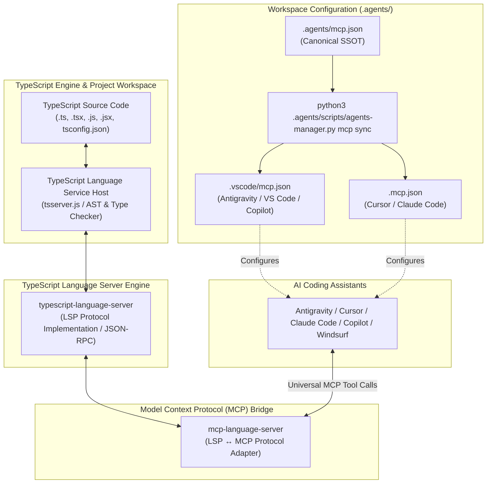
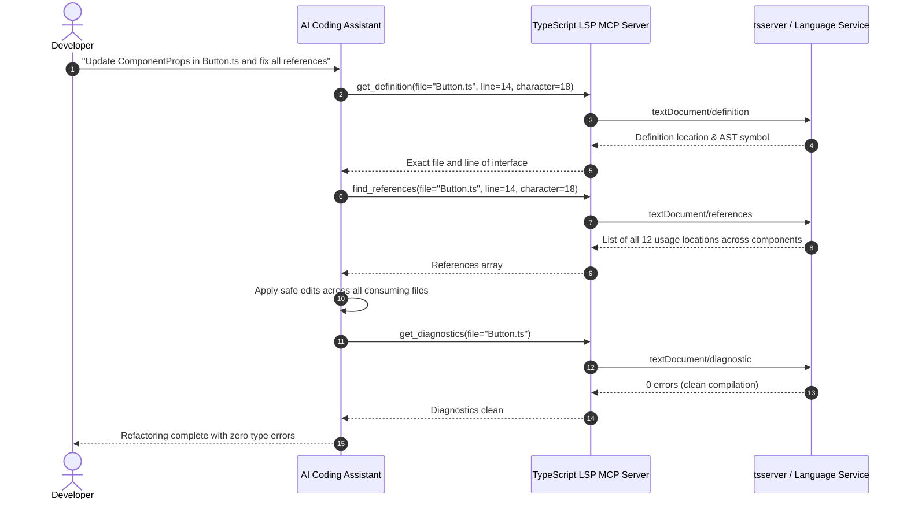

# TypeScript Language Server (LSP) MCP Server Guide

This document outlines the architecture, configuration, core tools, and usage workflows for the **TypeScript Language Server Model Context Protocol (MCP) Server** (`typescript-lsp`). It serves as a comprehensive reference for frontend engineers and AI coding assistants (**Antigravity**, **Cursor**, **Claude Code**, **VS Code / GitHub Copilot**, and **Windsurf**) working in this repository.

---

## 1. Overview & Architecture

Modern AI coding assistants frequently struggle with hallucinated imports, outdated type signatures, and subtle type discrepancies when relying purely on regex searches or file-reading tools. 

The **TypeScript LSP MCP Server** bridges Microsoft's official TypeScript Language Service (`tsserver`) with AI agents through a standardized Model Context Protocol (MCP) interface:



### Key Advantages:
1. **Semantic Type Grounding:** The assistant inspects actual compiler-resolved types instead of inferring types from raw text.
2. **Deterministic Cross-File Refactoring:** When renaming a property or modifying an interface, `find_references` locates every genuine call site across imports, aliases, and re-exports.
3. **Compiler-Grade Diagnostics:** Instant access to compile-time diagnostics (`TS2322`, `TS2339`, `TS2345`) before files are committed or tested in CI.
4. **Cross-Agent Neutrality:** All AI coding assistants access the same underlying language server through standard MCP tool calls.

---

## 2. Configuration & Multi-Agent Synchronization

In accordance with this repository's architectural guidelines ([AGENTS.md](../AGENTS.md)), the server is declared in the canonical `.agents/mcp.json` and synchronized across all AI tool adapters.

### A. Canonical Configuration ([.agents/mcp.json](../.agents/mcp.json))
```json
{
  "mcpServers": {
    "typescript-lsp": {
      "command": "npx",
      "args": [
        "-y",
        "mcp-language-server",
        "--workspace",
        ".",
        "--lsp",
        "typescript-language-server --stdio"
      ],
      "env": {},
      "description": "Universal TypeScript and JavaScript Language Server (LSP) bridge for semantic code intelligence, definitions, references, and diagnostics"
    }
  }
}
```

### B. Synchronize Adapters
To propagate configuration changes to `.vscode/mcp.json` and `.mcp.json`:
```bash
python3 .agents/scripts/agents-manager.py mcp sync
```

* **Antigravity & VS Code / GitHub Copilot:** Reads `.vscode/mcp.json`.
* **Cursor & Claude Code:** Reads `.mcp.json` in the workspace root.

---

## 3. How It Works: The Operational Loop

When an AI assistant refactors or inspects TypeScript code, it follows a deterministic query-and-verification loop:



---

## 4. Exposed Tools Reference

The bridge translates standard Language Server Protocol operations into structured MCP tools:

| Tool Name | Purpose | Key Parameters | Return Value |
| :--- | :--- | :--- | :--- |
| `get_definition` | Navigates to the declaration of a symbol (interface, function, class, variable). | `file`, `line`, `character` | Location URI, line range, and target symbol. |
| `find_references` | Finds all usages of a symbol across the entire workspace. | `file`, `line`, `character` | Array of source locations referencing the symbol. |
| `get_hover` | Retrieves the type signature, inferred types, and JSDoc comments at a cursor position. | `file`, `line`, `character` | Markdown-formatted type signature and docstring. |
| `get_diagnostics` | Retrieves compiler warnings, syntax errors, and type mismatches. | `file` (optional, project-wide if omitted) | Array of diagnostic items with severity, code (`TSxxxx`), and message. |
| `document_symbols` | Generates a hierarchical outline of all symbols in a file. | `file` | List of classes, interfaces, methods, and exported types. |
| `workspace_symbol` | Searches for symbols project-wide by name or substring. | `query` | Matching symbols across all workspace files. |

---

## 5. Official `typescript-language-server` Configuration Options

[`typescript-language-server`](https://github.com/typescript-language-server/typescript-language-server) supports extensive initialization options to optimize performance and integrate language plugins:

### A. Initialization Options (`initializationOptions`)

| Option | Type | Default | Description |
| :--- | :--- | :--- | :--- |
| `maxTsServerMemory` | `number` | `undefined` | Maximum V8 heap size in MB (e.g. `4096` for 4GB). Recommended for large frontend monorepos. |
| `disableAutomaticTypingAcquisition` | `boolean` | `false` | Disables automatic fetching of `@types` from npm for external packages. |
| `completionDisableFilterText` | `boolean` | `false` | Controls client-side completion filtering. |
| `locale` | `string` | `undefined` | Language locale for TypeScript diagnostic messages (e.g. `"en"`). |
| `plugins` | `array` | `[]` | Array of TypeScript `tsserver` language service plugins (e.g. Lit, CSS modules). |
| `preferences` | `object` | `{}` | Direct compiler and formatting preferences passed to `tsserver`. |
| `tsserver` | `object` | `{}` | Fine-grained controls for spawning and debugging the underlying `tsserver` binary. |

### B. `tsserver` Options Block

Configured within initialization options under the `tsserver` key:

```json
{
  "tsserver": {
    "path": "./node_modules/typescript/lib/tsserver.js",
    "fallbackPath": "",
    "logDirectory": "./.logs/tsserver",
    "logVerbosity": "normal",
    "trace": "off"
  }
}
```

* **`tsserver.path`**: Ensures the language server runs the exact TypeScript version installed in the repository (`node_modules/typescript`), guaranteeing version parity with CI builds.
* **`logVerbosity`**: Logging detail level (`"terse"`, `"normal"`, `"verbose"`). Useful for debugging complex type resolution issues.

### C. Useful `preferences` for AI Coding Agents

```json
{
  "preferences": {
    "quotePreference": "single",
    "importModuleSpecifierPreference": "non-relative",
    "includePackageJsonAutoImports": "auto",
    "allowRenameOfImportPath": true
  }
}
```

---

## 6. Frontend & Design System Integration Best Practices

In a modern frontend repository (such as this workspace containing Web Components, Lit, TypeScript, and Storybook):

### 1. Web Components & Lit HTML Typing
When authoring custom elements with Lit or vanilla Web Components, install the TypeScript Lit plugin so the language server validates HTML templates and custom element tags:
```bash
npm install -D typescript-lit-html-plugin
```
Then configure in `tsconfig.json`:
```json
{
  "compilerOptions": {
    "plugins": [
      { "name": "typescript-lit-html-plugin" }
    ]
  }
}
```

### 2. Storybook Component Contracts
When defining component story contracts (e.g. `Meta<ButtonProps>`, `StoryObj<ButtonProps>`), the assistant uses `get_hover` and `get_definition` on component types to ensure all required controls and argTypes match the component interface exactly.

### 3. IDE vs. MCP Tooling Synergy
* **While writing code interactively**: Antigravity, Cursor, and VS Code handle real-time autocompletion and hover popups via their built-in editor services.
* **During autonomous agent workflows**: Agents invoke `get_diagnostics` and `find_references` via the MCP server to autonomously verify refactorings, validate PR diffs, and prevent type regressions without human intervention.

---

## 7. Verification & Health Diagnostics

To verify that the MCP server is properly configured and synchronized:

```bash
# 1. Run environment diagnostics
python3 .agents/scripts/agents-manager.py doctor

# 2. Verify all invariant checks pass
python3 .agents/scripts/agents-manager.py verify

# 3. Inspect MCP server list
python3 .agents/scripts/agents-manager.py mcp list
```
